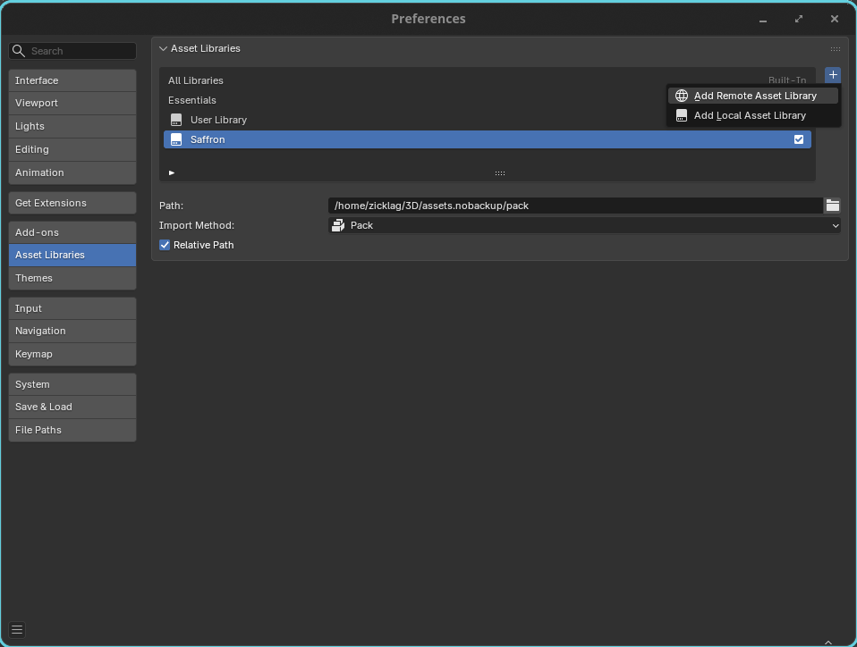
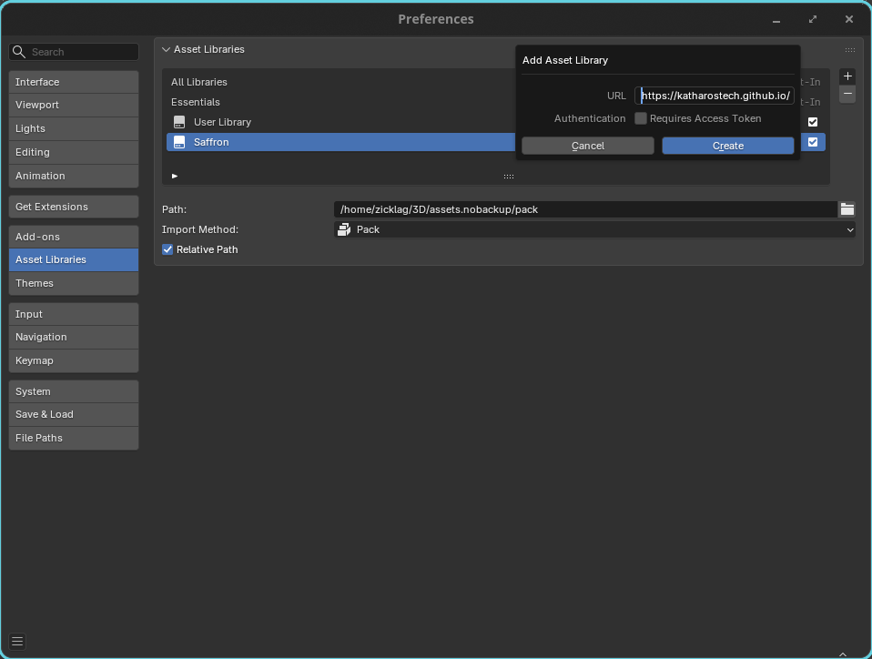
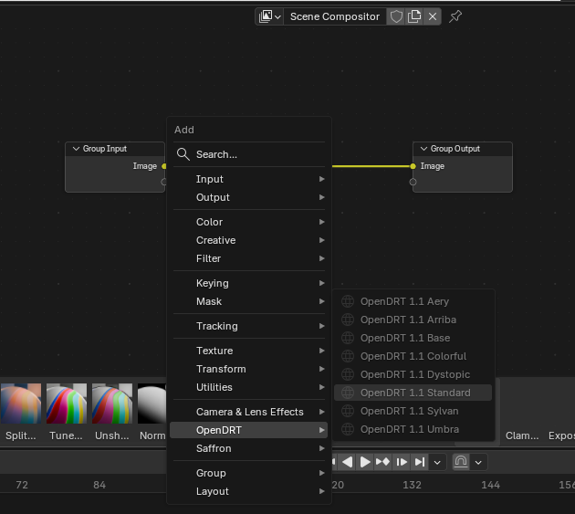
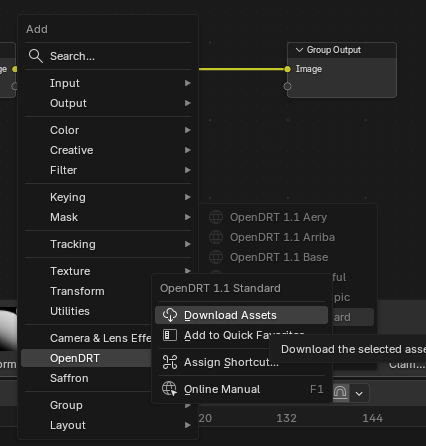
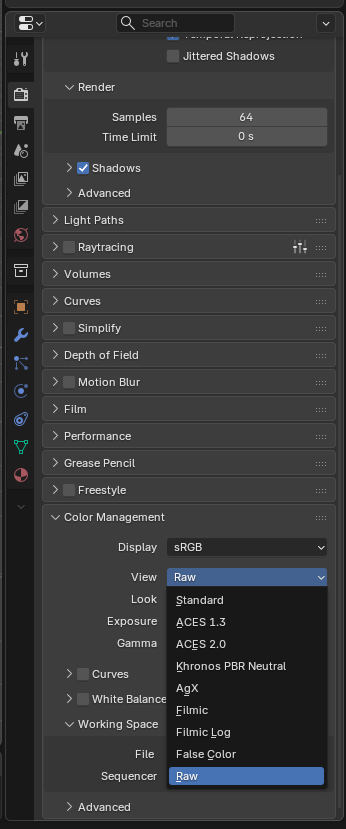
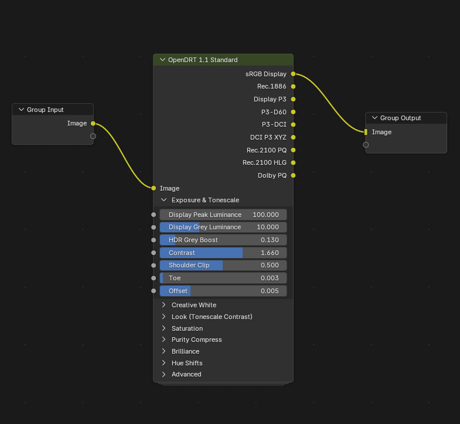

# Blender OpenDRT Compositor Nodes

> **Note:** This is relatively new and it isn't guaranteed that this **exactly** reproduces OpenDRT, but at the time of writing everything seems to be accurate. If you notice a divergence from the official OpenDRT implementation that's a bug, please open an issue!

This is repo creates a [Blender] asset pack containing compositor nodes for the [OpenDRT] picture formation algorithm.

OpenDRT is an alternative _view transform_ that could be used, for example, instead of **AgX**, or **Filmic**.

Unlike most view transforms, OpenDRT is extremely _customizable_. This is excellent because view transforms end up needing to encode artistic preferences inside them, and working around those inbuilt preferences can be difficult. Having a customizable view transform can help reduce the need to "fight" with the display transform and gives you a lot of flexibility.

This article is a good read for getting into the weeds on what might make OpenDRT a good picture formation algorithm: [What Makes a Good Picture ( Formation )][pf].

[Blender]: https://blender.org
[OpenDRT]: https://github.com/jedypod/open-display-transform/tree/main/display-transforms/opendrt#opendrt
[pf]: https://chrisbrejon.com/articles/what-makes-a-good-picture-formation/

## Installation

This is a Blender asset pack, **not** a Blender plugin. The handy thing about this is that if you add an OpenDRT node to your blend it is saved with your blend and can be opened by anybody that has not installed the asset pack. It's all packed into your file.

There are two ways to install the asset pack: through the online asset directory, or by downloading and installing it manually.

### Online Installation

For the online installation, first you need to add a new remote asset pack from the blender preferences:

You need to set the URL to `https://katharostech.github.io/opendrt-blend/` and click "Create".

After adding the asset pack you can go to the compositor workspace, create a new compositing tree and use `Shift+A` to bring up the add node menu. There will be a new OpenDRT section with the official OpenDRT presets listed in it.

Right-click on one of the presets and then click "Download Asset".

This will download the pack and unlock the nodes so that you can insert them into the node tree.

### Loal Installation

_These instructions are not as detailed as ideal and will be updated when time permits._

The asset pack can be installed locally by downloading the zip from the "Asset Pack" release on GitHub. Download and unzip the asset pack and you may then add the unzipped folder as a local blender asset pack in the Blender preferences.

## Usage

Because we are using OpenDRT as a node instead of a typical, non-customizable view transform, we will need to **disable** Blender's built-in view transform so that we don't apply two view transforms, which would result in very bad color output.

We can do this from the **Colorm Management** section of the Render properties tab.

Initially _this_ will make the colors look broken, because we no have **no** view transform, but we will fix that by adding our OpenDRT node to the compositor tree.

Start by creating a new compositor tree, and using `Shift+A` to add an OpenDRT node such as **OpenDRT Standard**.

You can drag this node between the input and the output and you're done!

You will find a **lot** of customization options in that node. Each of the settings has a pretty detailed description of what it does. You may find more useful info about how it works in the [OpenDRT documentation][dd].

[dd]: https://github.com/jedypod/open-display-transform/tree/main/display-transforms/opendrt/docs

All of the preset nodes are built on top of the **OpenDRT 1.1 Base** node, just with different settings, so you can make your own preset nodes if you want to just by making your own node group and changing the settings.

### Placement of the OpenDRT Node

**Important Note:** The view transform is usually the **very last** in your compositing tree when you use it like this. You can still do compositing _after_ the view transform if you wish, but there are caveats to it, and applying the view transform as the very last operation is what Blender does by default when you use the typical color management settings other than **Raw**.

If you want to learn more about the color management process and color grading in general, this excellent free course by the amazing folks at [Creative Shrimp][cs] is a great introduction to the concept: [A Free Mini-course on Color Grading With Render Raw][cg]. That course is specifically about the **Render Raw** Blender plugin, but the artistic concepts introduced are universal and it has a very gentle introduction to the concept of a view transform inside, as well as the difference between compositing before and after the view transform.

[cs]: https://www.creativeshrimp.com
[cg]: https://www.creativeshrimp.com/free-course-color-grading-render-raw

### OpenDRT Output Sockets

You may notice that there are 9 different output sockets on the OpenDRT nodes. Each output corresponds to a different display standard. For instance, if you are targeting typical web, mobile, and desktop platforms you are 99.9% surely going to want to simply use the sRGB output, as that is the standard for color across most applications and the web.

When targeting theaters or HDR displays, though, you need to select the output that is appropriate to that display. This completely changes the way that color is encoded and the gamut, or range of different colors, that are output. You shouldn't use anything other than sRGB unless you know what you are doing.

## AI Usage

The conversion scripts in this repo that were used to generate Blender node
groups from the OpenDRT reference implementation were written almost completely
by GLM 5.3, an AI model, using the omp coding harness, with significant steering
by @zicklag on the high-level and user-facing points. Almost all of the
user-facing documentation has been written by hand.

We know that many people are against the use of AI, especially in art, but we
believe that this use was appropriate. The conversion scripts are doing boring,
soulless work to convert artistic math by the author of OpenDRT from one format
to another. The details of this process are not very creative and no one is here
to enjoy the creativity of the scripts.

The end result of these scripts, is that we have an artistic tool available to
use in Blender which was previously only usable in proprietary software. We
think that this is a net benefit to the Blender artists and ecosystem.

### Code Status

The code quality has not been inspected in detail, but none of the python code
in this repo ends up inside your blend: only the final node graph converted by
the scripts are used inside Blender.

There is some AI-generated build instructions in [BUILD.md](./docs/ai/BUILD.md),
which we may extract into more human facing documentation later, so that it's
easier to run the scripts yourself. It's not hard to run them yourself already,
and that should get you started if you wish, we just generally prefer to have 
humans write what we mean humans to read, so those instructions are left in
`docs/ai` for now.
